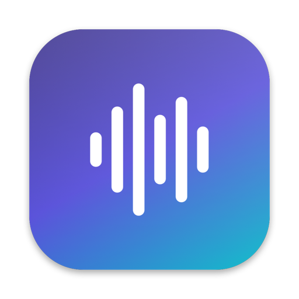
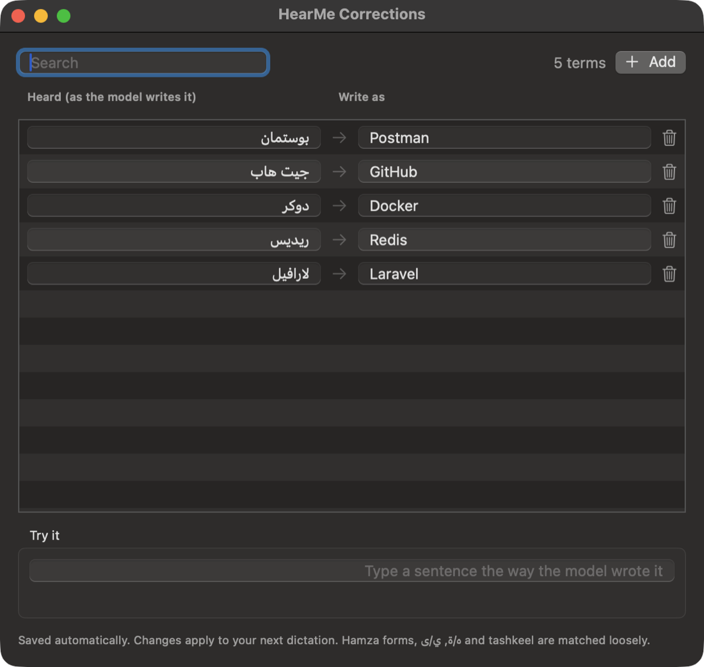

<p align="center"></p>

# HearMe

A small macOS menu bar dictation app for Arabic, English and a mix of both. Press a key, speak, and the text is pasted where your cursor is.

Everything runs on your Mac: audio never leaves it, and HearMe makes no network requests. The only download is the model, once, during setup.

- **Model:** [Cohere Transcribe Arabic 07-2026](https://huggingface.co/handy-computer/cohere-transcribe-arabic-07-2026-gguf) (Q8_0 GGUF), which handles Arabic and English.
- **Engine:** [transcribe.cpp](https://github.com/handy-computer/transcribe.cpp) 0.4.1 on Metal, with [Silero VAD](https://huggingface.co/handy-computer/silero-vad-v6.2-gguf) to cut silence and noise.
- **Speed:** about half a second to transcribe 10 seconds of speech on Apple Silicon.

## Requirements

- A Mac with Apple Silicon (M1 or later). Intel Macs are not supported.
- macOS 14 Sonoma or later.
- Xcode, or the Xcode Command Line Tools, with Swift 5.10 or later. To install the Command Line Tools: `xcode-select --install`.
- About 2.5 GB of free disk space for the model.

## Install

HearMe is built from source; there is no prebuilt download.

**1. Get the code:**

```bash
git clone https://github.com/mo-masoud/hearme.git
cd hearme
```

**2. Download the models** (about 2.4 GB, once). The script checks each file's SHA-256, resumes an interrupted download, and skips files already in place:

```bash
./scripts/download-models.sh
```

**3. Build and install.** This builds `HearMe.app`, copies it to `~/Applications` and starts it:

```bash
./scripts/build-app.sh --install
```

A waveform icon appears in the menu bar. It takes a few seconds the first time while the model loads.

**4. Grant permissions:**
1. **Accessibility:** choose **Grant Accessibility Access…** in the menu, then turn HearMe on in System Settings → Privacy & Security → Accessibility. HearMe needs it to paste and to cancel with Esc. Without it, the text is only copied to the clipboard.
2. **Microphone:** macOS asks the first time you record.

**5. Pick a shortcut.** The default is **F13**, which most keyboards don't have. Choose **Shortcut: F13** in the menu and press the combination you want, for example ⌃⌥D.

### Update

```bash
git pull
./scripts/build-app.sh --install
```

**About signing:** if you have an Apple Development certificate whose name contains your macOS user name, the build script signs with it, and macOS keeps the Microphone and Accessibility permissions across updates. Set `HEARME_SIGN_IDENTITY` to pick another certificate. Without one, the app is signed ad-hoc and works the same, but after each rebuild you need to remove HearMe from the Accessibility list and add it again.

### Uninstall

Quit HearMe from its menu, then:

```bash
rm -rf ~/Applications/HearMe.app "$HOME/Library/Application Support/HearMe"
defaults delete com.masoud.hearme
```

The second command also deletes the models, your corrections and your recordings.

## Use

| Action | What happens |
|---|---|
| Hold the shortcut, speak, release | Records while held, then transcribes and pastes |
| Tap the shortcut, speak, tap again | Same thing, hands-free |
| **Esc** while recording | Cancels |

The menu bar icon shows the state: waveform when ready, red mic while recording, dots while transcribing. If the icon is an orange mic, the microphone is still waking up (common with Bluetooth headsets); start speaking when it turns red.

Before transcription, Silero VAD keeps only the parts where you speak. A clip with no speech is dropped, and tags the model writes for noise (`@@@ضوضاء`) or filler sounds (`<hesitation>`) are removed from the text.

### Menu

- **Copy last:** copies the last transcription again.
- **Mode:** **Hold to Talk** (records while the key is held; a quick tap also works hands-free) or **Press to Start, Press to Stop**.
- **Microphone:** **System Default**, the built-in mic, or any other input. The built-in mic records only silence while a MacBook's lid is closed; HearMe warns if a clip is all silence.
- **Keep Microphone Ready:** keeps the mic open for **30 seconds** (default) or **15 seconds** after dictating, so the next dictation starts instantly and includes the 0.3 s before the key press. **Off** closes the mic after each dictation. A Bluetooth headset needs 1.5–2 s to switch its mic on, so this helps most there.
- **Language:** Arabic (the default, keeps English terms) or English.
- **Shortcut:** opens a small window; press the new combination, or Esc to cancel. HearMe refuses combinations that would get in the way: Esc, a plain key without ⌘, ⌥ or ⌃ (F-keys are fine), ⌘ plus one key, and system shortcuts such as ⌘Space, ⌃Space, ⌘Tab and the screenshot keys. If another app already owns the combination, HearMe keeps the old one. **Reset Shortcut to F13** brings back the default. Lone modifier keys such as Right ⌥ aren't supported.
- **Edit Corrections…:** see below.
- **History…:** every dictation with its date and length. Play the recording, copy or edit the text, or move it to the Trash. **Delete recordings older than** (1 week, 1 month, 2 months by default, 6 months, or never) removes old clips for good. Audio takes about 2 MB per minute of speech.
- **Launch at Login**

### Corrections

The model can't be taught new words, so HearMe fixes them after transcription. Each rule maps what the model writes to what you want, for example `لارافيل → Laravel`. This is useful for English terms written in Arabic letters, names, and words the model keeps mishearing.

<p align="center"></p>

Changes save automatically and apply to the next dictation. A rule matches any hamza form, ه/ة, ي/ى and tashkeel, so `لارافيل` also catches `لأرافيل`. The **Try it** box previews the rules on a sentence.

## Files

Everything lives in `~/Library/Application Support/HearMe/`:

- `models/`: the speech model and Silero VAD.
- `corrections.json`: your correction rules.
- `history/`: each dictation as a `.wav` with a `.json` holding what the model heard and what was pasted.
- `debug.log`: shortcut and microphone timings, for troubleshooting.

If a result looks wrong, play its recording in the History window. That tells you whether the microphone or the model was at fault.

To run the same pipeline on an audio file without the UI:

```bash
~/Applications/HearMe.app/Contents/MacOS/HearMe --transcribe some.wav --lang ar
```

## Known limits

- **Mixed Arabic and English:** English words often come out in Arabic letters. Add the ones you use to Corrections.
- **Long sentences:** the model sometimes drops the last word or two of a long clip. HearMe keeps recording for 250 ms after you release the key to reduce this.
- **Length:** a recording stops at 5 minutes.

## License

HearMe is released under the [MIT License](LICENSE).

It uses these components, each under its own license:

- transcribe.cpp and ggml (MIT), shipped prebuilt in `Vendor/lib`, with their licenses in `Vendor/lib/licenses`.
- The Cohere Transcribe Arabic model (Apache-2.0) and Silero VAD (MIT), downloaded by `scripts/download-models.sh`.
